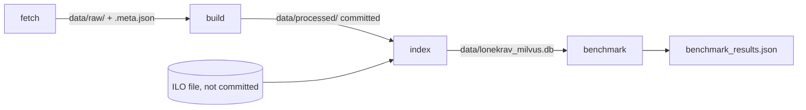

# Walkthrough: the Feature 001 data pipeline

How a raw download becomes an occupation profile, a salary row and a ranked search hit. Every
snippet below is emitted from the file on disk by `sed`, so it is the code as committed. Read it
top to bottom: it follows the four CLI steps in the order they run.



## 1. Every download goes through one cached, atomic function

All sources (SCB, JobTech, ILO, ESCO, the SCB publication) call `cached_get`. It writes to a
temporary file and renames only after the download succeeded and passed `validate`, so a failed
fetch can never replace good cached data. The `.meta.json` beside each file records when it was
downloaded; that time, not the build time, becomes `fetched_at` on every salary row, which is why
two builds are byte-identical.

`src/lonekrav/etl/http.py` lines 36-70:

```python
def cached_get(
    source: str,
    url: str,
    dest: Path,
    *,
    params: dict[str, str] | None = None,
    client: httpx.Client | None = None,
    force: bool = False,
    validate: Callable[[bytes], object] | None = None,
) -> Path:
    """Download `url` to `dest` unless it is cached, writing `<dest>.meta.json` beside it."""
    if dest.exists() and meta_path(dest).exists() and not force:
        return dest
    own = client is None
    client = client or httpx.Client(timeout=120, follow_redirects=True,
                                    headers={"User-Agent": USER_AGENT})
    try:
        resp = client.get(url, params=params)
        resp.raise_for_status()
        data = resp.content
        if validate:
            validate(data)
    except Exception as e:
        raise FetchError(f"{source}: download failed for {url}: {e}") from e
    finally:
        if own:
            client.close()
    dest.parent.mkdir(parents=True, exist_ok=True)
    tmp = dest.with_name(dest.name + ".tmp")
    tmp.write_bytes(data)
    tmp.replace(dest)
    meta = Meta(url=url, params=params or {}, fetched_at=dt.datetime.now(dt.UTC),
                sha256=hashlib.sha256(data).hexdigest())
    meta_path(dest).write_text(json.dumps(meta.model_dump(mode="json"), indent=1))
    return dest
```

ESCO needs one extra rule on top. JobTech links to 81 occupations that ESCO no longer serves
(404s, and one permanent 500 with a "CognizoneException" body). Those are recorded and skipped;
anything else stops the fetch. Both behaviours were found on the live run and are pinned by tests
in `tests/unit/test_esco.py`.

`src/lonekrav/etl/esco.py` lines 35-49:

```python
def _unservable(e: FetchError) -> bool:
    """404 (removed from ESCO) or a 500 carrying ESCO's own error body (a data defect for that
    one occupation, seen live as CognizoneException). Network errors and 503s are not."""
    cause = e.__cause__
    if not isinstance(cause, httpx.HTTPStatusError):
        return False
    r = cause.response
    if r.status_code == 404:
        return True
    try:
        return r.status_code == 500 and "logref" in r.json()
    except ValueError:
        return False


```

## 2. Salary tables: json-stat2 cells to validated rows

SCB's PxWeb v2 returns json-stat2: a flat `value` array in row-major order over the dimensions in
`id`. `_cells` turns each position back into named category codes. A suppressed cell is `null`
in `value` (with status `".."`), and it stays `None` all the way into the Parquet file.

`src/lonekrav/etl/scb_pxweb.py` lines 69-84:

```python
def _cells(path: Path) -> Iterator[dict[str, str | int | None]]:
    """Yield one dict per cell: dimension -> category code, plus 'label' and 'value'."""
    j = json.loads(path.read_text())
    dims = j["id"]
    cats = {}
    for d in dims:
        pos = j["dimension"][d]["category"]["index"]
        cats[d] = sorted(pos, key=pos.get)
    labels = j["dimension"]["ContentsCode"]["category"]["label"]
    for i, combo in enumerate(itertools.product(*(cats[d] for d in dims))):
        cell = dict(zip(dims, combo, strict=True))
        cell["label"] = labels[cell["ContentsCode"]]
        cell["value"] = j["value"][i]  # null when SCB suppresses the cell (status "..")
        yield cell


```

Two tables cover two periods (TAB4265 for 2014–2022, TAB5932 for 2023 onwards). Rows are keyed
by (code, year), so each year comes from exactly one table. `SalaryDistribution`'s validator
rejects unordered percentiles with the code and year in the message: the build fails rather than
"fixing" SCB data.

`src/lonekrav/etl/scb_pxweb.py` lines 121-130:

```python
def build_distributions(raw: Path) -> list[SalaryDistribution]:
    """Both tables, each year from exactly one table (the newer table wins on overlap)."""
    rows: dict[tuple[str, int], SalaryDistribution] = {}
    for t in DISTRIBUTION_TABLES:
        p = raw / "pxweb" / f"{t}.json"
        for r in parse_distributions(p, t, read_meta(p).fetched_at):
            rows[(r.code, r.year)] = r
    return [rows[k] for k in sorted(rows)]


```


`src/lonekrav/core/models.py` lines 113-121:

```python
    def _check(self):
        if self.reference_year != self.year:
            raise ValueError(f"{self.code} {self.year}: reference_year {self.reference_year}")
        present = [(f, getattr(self, f)) for f in ORDERED if getattr(self, f) is not None]
        for (fa, a), (fb, b) in itertools.pairwise(present):
            if a > b:
                raise ValueError(f"{self.code} {self.year}: {fa}={a} > {fb}={b} in SCB data")
        return self

```

## 3. Profiles: one per salary-table code, with a source on everything

The canonical code set is the salary table's (429 codes). The SCB structure workbook lacks the
three military codes, and JobTech lacks 54 codes, 50 of them because it merges manager levels
(1211 and 1212 become 1210). `expand_merged` maps a merged JobTech group back onto every SCB code
in the same 3-digit group:

`src/lonekrav/etl/jobtech.py` lines 74-200:

```python
def expand_merged(groups: dict[str, Group], scb_codes: set[str]) -> dict[str, Group]:
    """Key groups by SCB code. JobTech merges manager levels (1210 for 1211 and 1212):
    a JobTech code not used by SCB is attached to every SCB code in the same 3-digit group."""
    out = {c: g for c, g in groups.items() if c in scb_codes}
    for c, g in groups.items():
        if c in scb_codes:
            continue
        levels = sorted(s for s in scb_codes if s[:3] == c[:3] and s not in groups)
        for s in levels:
            out[s] = g.model_copy(update={"shared_with": levels})
    return out
```

`_profile` then applies the source precedence. The Swedish description comes from JobTech
unless the group is merged or missing, in which case the level-specific text comes from SCB's
SSYK 2012 publication. ESCO labels arrive only through exact, close or narrow matches; a broad
match can point at a concept spanning other SSYK codes.

`src/lonekrav/core/profiles.py` lines 64-106:

```python
def _profile(code: str, inp: Inputs) -> OccupationProfile:
    jt = inp.jobtech_by_scb.get(code)
    shared = bool(jt and jt.shared_with)
    isco = inp.isco_key.get(code) or []
    ilo_groups = [inp.ilo[i] for i in isco if i in inp.ilo]
    title_en = inp.english.get(code) or (ilo_groups[0].title if ilo_groups else "")
    sources = [REFS["scb_structure"] if code in inp.structure else REFS["scb_pxweb"]]

    descriptions: list[Text] = []
    if jt and jt.definition and not shared:
        descriptions.append(Text(lang="sv", kind="definition", text=jt.definition,
                                 source=REFS["jobtech"]))
    elif code in inp.mis:
        descriptions.append(Text(lang="sv", kind="definition", text=inp.mis[code],
                                 source=REFS["scb_mis2012"]))
        sources.append(REFS["scb_mis2012"])
        if jt and jt.definition:
            descriptions.append(Text(lang="sv", kind="definition", text=jt.definition,
                                     source=REFS["jobtech"], shared_with=jt.shared_with))
    if ilo_groups and code not in inp.english:
        sources.append(REFS["ilo_isco08"])  # English title only (military codes)
    if code in inp.english:
        sources.append(REFS["scb_english"])
    if jt:
        sources.append(REFS["jobtech"])

    synonyms = [Synonym(lang="sv", label=t, source=REFS["scb_title_index"])
                for t in inp.title_index.get(code, [])]
    esco_seen = []
    for n in jt.names if jt else []:
        synonyms.append(Synonym(lang="sv", label=n.label, source=REFS["jobtech"], jobtech_id=n.id))
        synonyms += [Synonym(lang="sv", label=a, source=REFS["jobtech"], jobtech_id=n.id)
                     for a in n.alt_labels]
        for m in n.esco:
            occ = inp.esco.get(m.uri)
            if m.match_type not in ESCO_MATCHES or occ is None:
                continue
            esco_seen.append(occ)
            for lang in ("en", "sv"):
                labels = [occ.label.get(lang)] + occ.alt.get(lang, [])
                synonyms += [Synonym(lang=lang, label=lab, source=ESCO, esco_uri=occ.uri,
                                     match_type=m.match_type)
                             for lab in labels if lab]
```

The publication parser is the most fragile piece. It reads only pages whose running header names
a "Yrkesområde" (the overview list and appendices also contain code lines). It closes an entry at
the next code, at a group heading, or at a gap in page numbers. An entry line is four digits,
whitespace and a capitalised title: the real page 38 prints `1311 IT-chefer` with one space, and
the first version of the pattern, which wanted two, silently dropped 35 codes.

`src/lonekrav/etl/mis2012.py` lines 60-100:

```python
def parse(pages: dict[int, str]) -> dict[str, str]:
    descriptions: dict[str, str] = {}
    code: str | None = None
    body: list[str] = []
    in_title = False

    def close():
        if code and body:
            descriptions[code] = _join(body)

    previous = None
    for number, text in sorted(pages.items()):
        if not _is_description_page(text):
            continue
        if previous is not None and number != previous + 1:
            close()  # never carry an entry across a gap in the page sequence
            code, body, in_title = None, [], False
        previous = number
        for line in text.splitlines()[1:]:
            if FOOTER.match(line.strip()):
                continue
            if m := ENTRY.match(line.strip()):
                close()
                code, body, in_title = m.group(1), [], True
            elif HEADING.match(line.strip()):
                close()
                code, body, in_title = None, [], False
            elif code:
                if in_title and line.startswith(" "):
                    continue  # title continuation such as " nivå 1"
                in_title = False
                body.append(line)
    close()
    return descriptions
```

ILO reserves reproduction rights for its ISCO-08 definitions, so `build_profiles` writes
profiles without ILO text, and `attach_ilo` adds the definitions, tasks and unambiguous example
titles only when the index is built:

`src/lonekrav/core/profiles.py` lines 139-165:

```python
def attach_ilo(profiles: dict[str, OccupationProfile], ilo: dict,
               isco_key: dict[str, list[str]]) -> dict[str, OccupationProfile]:
    """Add ILO ISCO-08 English definitions, tasks and example titles. Example titles are added
    only where the ISCO group maps to this one SSYK code, so they cannot point elsewhere."""
    owners: dict[str, list[str]] = defaultdict(list)
    for code in sorted(profiles):
        for i in isco_key.get(code, []):
            owners[i].append(code)
    out = {}
    for code, p in profiles.items():
        groups = [ilo[i] for i in p.isco_codes if i in ilo]
        if not groups:
            out[code] = p
            continue
        ref = REFS["ilo_isco08"]
        texts = [Text(lang="en", kind=kind, text=text, source=ref, isco_code=g.code)
                 for g in groups for kind, text in (("definition", g.definition), ("tasks", g.tasks))
                 if text]
        titles = [Synonym(lang="en", label=t, source=ref)
                  for g in groups if owners.get(g.code) == [code] for t in g.included]
        sources = p.sources if ref in p.sources else [*p.sources, ref]
        out[code] = p.model_copy(update={"descriptions": [*p.descriptions, *texts],
                                         "synonyms": dedupe_synonyms([*p.synonyms, *titles]),
                                         "sources": sources})
    return out


```

## 4. Index: chunks, two dense fields and BM25 in one Milvus Lite collection

KBLab truncates at 384 tokens, so a profile is split into chunks (titles, each description,
synonym blocks of at most 40 labels and 2 000 characters). Benchmark hold-out titles are dropped
here. The store saves the analysis vocabulary beside a local index (`<db>.vocab.json`), so a
reopened or copied index analyses queries exactly as its documents were analysed.

`src/lonekrav/core/chunks.py` lines 44-76:

```python
def _batches(labels: list[str]) -> list[str]:
    """Join labels with '; ', at most MAX_LABELS and MAX_CHARS per batch."""
    out, cur = [], []
    for label in labels:
        label = label[:MAX_CHARS]
        if cur and (len(cur) == MAX_LABELS or len("; ".join([*cur, label])) > MAX_CHARS):
            out.append("; ".join(cur))
            cur = []
        cur.append(label)
    if cur:
        out.append("; ".join(cur))
    return out


def chunk_profile(p: OccupationProfile, holdout: set[str] = frozenset()) -> list[Chunk]:
    """`holdout`: case-folded titles used as benchmark queries, kept out of the indexed text."""
    chunks: list[Chunk] = []

    def add(kind, lang, text):
        n = sum(c.kind == kind for c in chunks)
        chunks.append(Chunk(chunk_id=f"{p.code}:{kind}:{n}", code=p.code, kind=kind, lang=lang,
                            text=text))

    add("title", "mixed", f"{p.title_sv} / {p.title_en}")
    for d in p.descriptions:
        for piece in _split(d.text):
            add(f"desc_{d.lang}", d.lang, piece)
    for lang in ("sv", "en"):
        labels = [s.label for s in p.synonyms
                  if s.lang == lang and s.label.casefold().strip() not in holdout]
        for batch in _batches(labels):
            add(f"synonyms_{lang}", lang, batch)
    return chunks
```


`src/lonekrav/core/store.py` lines 52-74:

```python
    def create(self) -> None:
        if self.client.has_collection(COLLECTION):
            self.client.drop_collection(COLLECTION)
        s = self.client.create_schema(auto_id=False)
        s.add_field("chunk_id", DataType.VARCHAR, max_length=64, is_primary=True)
        s.add_field("code", DataType.VARCHAR, max_length=4)
        s.add_field("kind", DataType.VARCHAR, max_length=16)
        s.add_field("lang", DataType.VARCHAR, max_length=8)
        s.add_field("text", DataType.VARCHAR, max_length=MAX_CHARS * 4)
        s.add_field("bm25_text", DataType.VARCHAR, max_length=MAX_CHARS * 12,
                    enable_analyzer=True, analyzer_params={"type": "standard"})
        s.add_field("bm25", DataType.SPARSE_FLOAT_VECTOR)
        s.add_function(Function(name="bm25_fn", function_type=FunctionType.BM25,
                                input_field_names=["bm25_text"], output_field_names=["bm25"]))
        ip = self.client.prepare_index_params()
        ip.add_index("bm25", index_type="SPARSE_INVERTED_INDEX", metric_type="BM25")
        for name, dim in self.dims.items():
            s.add_field(f"vec_{name}", DataType.FLOAT_VECTOR, dim=dim)
            ip.add_index(f"vec_{name}", index_type="FLAT", metric_type="COSINE")
        self.client.create_collection(COLLECTION, schema=s, index_params=ip)
        if self._vocab_file:
            self._vocab_file.write_text(json.dumps(sorted(self.vocab), ensure_ascii=False))

```

## 5. Search: reduce chunks to occupations, then fuse

Each method returns up to 200 chunks. They are reduced to one score per occupation (the best
chunk), and only then fused with reciprocal rank fusion. Milvus's own `RRFRanker` would fuse
chunk lists, which over-rewards occupations with many similar chunks. Milvus Lite reports BM25
scores as negative numbers; `bm25_score` takes the absolute value, which is also correct for a
Milvus server.

`src/lonekrav/core/search.py` lines 45-76:

```python
def reduce_to_codes(hits: Sequence[ChunkHit]) -> list[tuple[str, ChunkHit]]:
    """Best chunk per occupation, ordered by score (highest first)."""
    best: dict[str, ChunkHit] = {}
    for h in hits:
        if h.code not in best or h.score > best[h.code].score:
            best[h.code] = h
    return sorted(best.items(), key=lambda kv: (-kv[1].score, kv[0]))


def fuse(per_method: Mapping[str, list[tuple[str, ChunkHit]]], k: int = 5) -> list[SearchHit]:
    methods = list(per_method)
    ranks = {m: {code: r for r, (code, _) in enumerate(lst, 1)} for m, lst in per_method.items()}
    chunks = {m: dict(lst) for m, lst in per_method.items()}
    codes = {c for lst in per_method.values() for c, _ in lst}
    scored = []
    for code in codes:
        fused = sum(1 / (RRF_K + ranks[m][code]) for m in methods if code in ranks[m])
        top = min((m for m in methods if code in ranks[m]), key=lambda m: ranks[m][code])
        scored.append((fused, code, top))
    scored.sort(key=lambda t: (-t[0], t[1]))
    out = []
    for i, (fused, code, top) in enumerate(scored[:k], 1):
        best = chunks[top][code]
        out.append(SearchHit(
            code=code,
            scores={m: chunks[m][code].score if code in chunks[m] else None for m in methods},
            ranks={m: ranks[m].get(code) for m in methods},
            fused_score=fused, fused_rank=i,
            matched_chunk=MatchedChunk(kind=best.kind, text=best.text),
        ))
    return out

```

## 6. Benchmark: generated titles that the index has never seen

Generated queries are one JobTech occupation-name per group, with the official code as the
answer. Every sampled title, its alternative labels and its English ESCO label are written to
`benchmark_holdout.json` and removed from the index. Hold-out removes whole labels only, so a
title that would still appear in its answer's indexed text (its official title, a description,
ILO text, or a longer label such as `Minister, statsråd`) is never sampled. Without that, the
benchmark would measure lookup, not matching.

`src/lonekrav/etl/benchmark.py` lines 27-87:

```python
class _Leaks:
    """Does a phrase survive in the indexed text of its answer once its own labels are held out?
    Mirrors `chunk_profile`: titles and descriptions always stay, synonyms go by whole label."""

    def __init__(self, profiles: dict[str, OccupationProfile]):
        self.fixed = {c: " ".join([p.title_sv, p.title_en, *(d.text for d in p.descriptions)])
                      .casefold() for c, p in profiles.items()}
        self.labels = {c: [s.label.casefold().strip() for s in p.synonyms]
                       for c, p in profiles.items()}

    def __call__(self, phrase: str, codes: list[str], held: set[str]) -> bool:
        pat = re.compile(rf"(?<!\w){re.escape(phrase.casefold().strip())}(?!\w)")
        return any(pat.search(self.fixed[c])
                   or any(pat.search(lab) for lab in self.labels[c] if lab not in held)
                   for c in codes)


def generate_queries(inputs: Inputs, profiles: dict[str, OccupationProfile],
                     seed: int = SEED) -> tuple[list[BenchmarkQuery], set[str]]:
    """One title query per JobTech group, labelled with its official SSYK code(s).

    Skips official occupation titles, titles that also belong to other occupations, and titles that would still appear in
    the indexed text of their answer after hold-out (in its title, a description, ILO text or a
    longer label), since those test lookup rather than retrieval. Returns the queries and the
    case-folded titles to hold out of the index.
    """
    rng = random.Random(seed)
    official = {p.title_sv.casefold() for p in profiles.values()}
    leaks = _Leaks(attach_ilo(profiles, inputs.ilo, inputs.isco_key))
    owners_sv, owners_en = _owners(profiles, "sv"), _owners(profiles, "en")
    queries, held = [], set()
    for jt_code, group in sorted(inputs.jobtech.items()):
        expected = sorted(c for c, g in inputs.jobtech_by_scb.items()
                          if g.concept_id == group.concept_id and c in profiles)

        def own(n, *extra):
            return {n.label.casefold().strip(), *(a.casefold().strip() for a in n.alt_labels),
                    *(e.casefold().strip() for e in extra)}

        candidates = [n for n in group.names
                      if (k := n.label.casefold().strip()) not in official
                      and owners_sv.get(k, set()) <= set(expected)
                      and not leaks(n.label, expected, own(n))]
        if not expected or not candidates:
            continue
        name = rng.choice(candidates)
        text_en = None
        for m in name.esco:
            occ = inputs.esco.get(m.uri)
            label = occ.label.get("en") if occ and m.match_type in ("exact", "close") else None
            if (label and owners_en.get(label.casefold(), set()) <= set(expected)
                    and not leaks(label, expected, own(name, label))):
                text_en = label
                break
        queries.append(BenchmarkQuery(id=f"gen-{jt_code}", origin="generated", type="title",
                                      text_sv=name.label, text_en=text_en,
                                      expected_codes=expected))
        held |= {name.label.casefold().strip(), *(a.casefold().strip() for a in name.alt_labels)}
        if text_en:
            held.add(text_en.casefold().strip())
    return queries, held
```

`evaluate` reports metrics per method, language and query set. `all_paired` holds only queries
that exist in both languages, so the English–Swedish gap compares like with like. The gate in
`tests/eval/test_benchmark.py` (run with `uv run pytest -m benchmark`) asserts SC-004 to SC-006.

## What surprised me

- Harrier's checkpoint loads as bfloat16, which is ten times slower than float32 on an Apple CPU.
- The SCB publication and the ESCO API each broke on the first real run in a way no fixture
  showed. Both are now regression tests.
- The SCB salary tables name Medlingsinstitutet as their producer, which changes the attribution
  the app must show.
