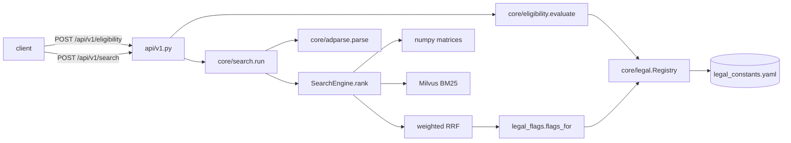

# Walkthrough: Feature 002, search, eligibility and salary API

How two real requests travel through the code: an eligibility check and a search. Every snippet
below was emitted from disk by `sed -n` when this file was generated (2026-10-21, branch
`002-search-eligibility-api`), so it is the code as it stands, not a paraphrase.



The adapter (`api/v1.py`) only validates, calls core and returns core models (constitution
Principle I). Everything interesting is in `core/`.

## Part 1: an eligibility check

### 1. The route

`src/lonekrav/api/v1.py:42`

```python
@router.post("/eligibility")
```

FastAPI validates the body against `EligibilityRequest` before this runs, so a bad field never
reaches core and comes back as a 422 naming it. The only thing the route adds is turning
`UnknownCode` into a 404. `_known` is the profiles dictionary loaded once at start-up.

### 2. The request model refuses impossible combinations

`src/lonekrav/core/eligibility.py:27`

```python
class EligibilityRequest(BaseModel):
    code: str = Field(pattern=r"^\d{4}$")
    monthly_salary_sek: int = Field(gt=0, description="Gross monthly salary actually paid")
    fte_percent: int = Field(ge=1, le=100, description="Share of full time")
    application_type: Literal["first_permit", "extension"]
    filed_on: dt.date
    decided_on: dt.date = Field(default_factory=dt.date.today,
                                description="Expected decision date; defaults to today")
    current_permit_granted_on: dt.date | None = Field(
        default=None, description="Decision date of the current permit (extensions only)")
    exemptions: list[str] = Field(default=[], description="Declared personal exemption ids")

    @field_validator("exemptions")
    @classmethod
    def _known_and_unique(cls, v: list[str]) -> list[str]:
        known = load_registry().exemptions
        if unknown := [e for e in v if e not in known]:
            raise ValueError(f"unknown exemptions {unknown}; expected some of {sorted(known)}")
        if len(set(v)) != len(v):
            raise ValueError("exemptions must be unique")
        return v

    @model_validator(mode="after")
    def _consistent(self):
        if (self.application_type == "extension") != (self.current_permit_granted_on is not None):
            raise ValueError("current_permit_granted_on is required for an extension and only "
                             "allowed for one")
        if self.decided_on < self.filed_on:
            raise ValueError("decided_on cannot be before filed_on")
        exemptions = load_registry().exemptions
        if self.application_type == "extension" and any(
                exemptions[e].first_permit_only for e in self.exemptions):
            raise ValueError("exemptions: former_student_researcher applies to first permits only")
        return self
```

Field rules cover single values (a 4-digit code, salary above zero, 1–100 % of full time). The
model validator covers combinations that the spec calls invalid: a current-permit date on a
first permit (or none on an extension), a decision before the filing, and the
former-student exemption on an extension, which Migrationsverket defines for first permits only.
The exemption ids are checked against the registry, not a hard-coded list.

### 3. Where every number comes from: the registry

The thresholds are not in Python. They are rows in a YAML file, each with a source and a
checked-on date:

`src/lonekrav/core/legal_constants.yaml:30`

```yaml
medians:
  - {amount: 32400, scb_reference_year: 2020, effective_from: 2021-06-22, source: mv_lonekrav}
  - {amount: 33200, scb_reference_year: 2021, effective_from: 2022-06-21, source: mv_lonekrav}
  - {amount: 34200, scb_reference_year: 2022, effective_from: 2023-06-20, source: mv_lonekrav}
  - {amount: 35600, scb_reference_year: 2023, effective_from: 2024-06-18, source: mv_lonekrav}
  - {amount: 37100, scb_reference_year: 2024, effective_from: 2025-06-17, source: mv_lonekrav}
  - {amount: 38300, scb_reference_year: 2025, effective_from: 2026-06-16, source: mv_lonekrav}
```

`src/lonekrav/core/legal_constants.yaml:77`

```yaml
  transition_maintenance_80:
    kind: share_of_median
    percent: 80
    effective_from: 2026-06-01
    effective_to: 2026-12-01
    permits_granted_before: 2026-06-01
    applies_to: >-
      Extensions filed 1 June–1 December 2026 for a permit granted before 1 June 2026 keep the
      earlier maintenance requirement: at least 80 % of the median, with no 75 % exemption.
    source: mv_god_forsorjning
```

`load_registry` turns this into pydantic models. It refuses a row without a source and fills each
median's `effective_to` from the next row, so the medians cannot overlap or leave a gap:

`src/lonekrav/core/legal.py:166`

```python
def load_registry(path: Path = REGISTRY_FILE) -> Registry:
    raw = yaml.safe_load(Path(path).read_text())
    sources = {k: Source(key=k, **v) for k, v in raw["sources"].items()}
    medians = [_with_source("medians", i, r, sources) for i, r in enumerate(raw["medians"])]
    medians.sort(key=lambda r: r["effective_from"])
    for a, b in itertools.pairwise(medians):
        a["effective_to"] = b["effective_from"] - dt.timedelta(days=1)
    keyed = {name: {k: _with_source(name, k, {"id": k, **v}, sources)
                    for k, v in raw[name].items()}
             for name in ("rules", "exemptions", "statements")}
    code_lists = {k: _with_source("code_lists", k, {"kind": k, **v}, sources)
                  for k, v in raw["code_lists"].items()}
    return Registry(
        medians=medians,
        median_publication_window=_with_source("median_publication_window", 0,
                                               raw["median_publication_window"], sources),
        code_lists=code_lists, **keyed,
    )
```

The lookups the eligibility code uses are small:

`src/lonekrav/core/legal.py:111`

```python
    def median_on(self, on: dt.date) -> MedianRecord | None:
        """The median in force on a day: from the day it takes effect, inclusive."""
        return next((m for m in reversed(self.medians) if _active(m, on)), None)

    def threshold(self, rule_id: str, median: MedianRecord) -> int:
        rule = self.rules[rule_id]
        if rule.kind == "flat":
            return rule.amount
        return round_half_up(rule.percent * median.amount / 100)

    def codes_on(self, kind: str, on: dt.date) -> dict[str, str]:
        cl = self.code_lists[kind]
        return dict(cl.codes) if _active(cl, on) else {}
```

`_active` treats both ends of a period as inclusive, which is what makes "the median applies from
the day it takes effect" and "the transition runs to 1 December inclusive" true without special
cases. `threshold` multiplies with `Decimal` and rounds half up; the registry test checks that this
reproduces every amount Migrationsverket publishes for 2021–2026.

### 4. Choosing the rule

`src/lonekrav/core/eligibility.py:121`

```python
def evaluate(req: EligibilityRequest, registry: Registry | None = None,
             known_codes: Container[str] | None = None) -> EligibilityAnswer:
    reg = registry or load_registry()
    if known_codes is not None and req.code not in known_codes:
        raise UnknownCode(req.code)
    median = reg.median_on(req.filed_on)
    warnings = _warnings(req, reg, median)

    if req.code in reg.codes_on("banned", req.decided_on):
        banned = reg.code_lists["banned"]
        return EligibilityAnswer(status="not_permitted", reason=banned.note, warnings=warnings,
                                 sources=_unique([banned.source, *(w.source for w in warnings)]))

    new_rule = reg.rules["salary_90"].effective_from
    decisive = req.decided_on if req.application_type == "first_permit" else req.filed_on
    if decisive < new_rule or median is None:
        st = reg.statements["out_of_scope"]
        return EligibilityAnswer(status="out_of_scope", reason=st.text, warnings=warnings,
                                 sources=_unique([st.source, *(w.source for w in warnings)]))

    rule_id, reason, decided_by = _rule(req, reg)
    rule = reg.rules[rule_id]
    threshold = reg.threshold(rule_id, median)
    margin = req.monthly_salary_sek - threshold
    return EligibilityAnswer(
        status="pass" if margin >= 0 else "fail", rule_id=rule_id, reason=reason,
        percent=float(rule.percent), median=median, threshold_sek=threshold, margin_sek=margin,
        margin_percent=round(margin / threshold * 100, 1), warnings=warnings,
        sources=_unique([rule.source, median.source, *decided_by,
                         *(w.source for w in warnings)]))
```

The order matters, and it follows data-model.md:

1. **Ban first.** 5343 is "not permitted" whatever the salary or exemption, so it short-circuits
   before any threshold is computed.
2. **Out of scope.** For a first permit the *decision* date decides whether the new rule applies;
   for an extension it is the *filing* date. Both are compared with `salary_90.effective_from`
   from the registry, not with a date in code.
3. **Then the rule itself:**

`src/lonekrav/core/eligibility.py:103`

```python
def _rule(req: EligibilityRequest, reg: Registry) -> tuple[str, str, list[Source]]:
    """(rule id, reason, sources that decided it) for a request that is in scope."""
    t = reg.rules["transition_maintenance_80"]
    if (req.application_type == "extension"
            and t.effective_from <= req.filed_on <= t.effective_to
            and req.current_permit_granted_on < t.permits_granted_before):
        return t.id, t.applies_to, [t.source]
    exempt = reg.code_lists["exempt_75"]
    if req.code in reg.codes_on("exempt_75", req.decided_on):
        return "salary_75_exempt", f"Occupation {req.code} is on the exempt list. {exempt.note}", \
            [exempt.source]
    if req.exemptions:
        ex = [reg.exemptions[e] for e in req.exemptions]
        why = "; ".join(f"{e.label}: {e.conditions}" for e in ex)
        return "salary_75_exempt", f"Declared exemption. {why}", [e.source for e in ex]
    return "salary_90", reg.rules["salary_90"].applies_to, []
```

The transitional extension is checked before the exempt list on purpose: an exempt code on a
transitional extension gets 80 %, not 75 %, because the 75 % level belongs to the new
requirement, which those extensions are not under (spec FR-012, research R6).

### 5. Warnings carry their sources

`src/lonekrav/core/eligibility.py:87`

```python
def _warnings(req: EligibilityRequest, reg: Registry, median: MedianRecord | None) -> list[Warning]:
    out = []
    if req.code in reg.codes_on("partially_banned", req.decided_on):
        st = reg.statements["partial_ban_9210"]
        out.append(Warning(kind="partial_ban", message=st.text, source=st.source))
    if req.fte_percent < 100:
        st = reg.statements["part_time"]
        out.append(Warning(kind="part_time", message=st.text, source=st.source))
    if median and reg.median_due(req.decided_on):
        out.append(Warning(kind="stale_median", source=median.source, message=(
            f"SCB publishes a new median every June and it may already apply. This answer uses "
            f"{sek(median.amount)} (SCB {median.scb_reference_year}), the newest in Lönekrav's "
            "registry.")))
    return out
```

Every warning text is either a registry statement or built from a registry row, and every warning
has a source (Principle III). The part-time statement cites Migrationsverket's page for employees,
which states the requirement as a monthly salary and gives no part-time reduction.

### 6. What comes back

The smoke transcript has the real answer for Story 1, scenario 1 (emitted from
`references/api-smoke.md`):

````text
$ sed -n '/^## Eligibility, scenario 1:/,/^## Eligibility, scenario 2/p' references/api-smoke.md | sed '$d' | head -60
## Eligibility, scenario 1: 2512 filed 16 June 2026

`POST /api/v1/eligibility` → **200**

```json
{"code": "2512", "monthly_salary_sek": 40000, "fte_percent": 100, "application_type": "first_permit", "filed_on": "2026-06-16", "decided_on": "2026-07-01"}
```

```json
{
 "status": "pass",
 "rule_id": "salary_90",
 "reason": "Salary requirement for first permits decided from 1 June 2026 and for extensions not covered by the transition: at least 90 % of the median in force when the application was filed.",
 "percent": 90.0,
 "median": {
  "amount": 38300,
  "scb_reference_year": 2025,
  "effective_from": "2026-06-16",
  "effective_to": null,
  "source": {
   "key": "mv_lonekrav",
   "title": "Migrationsverket: Lönekrav för arbetstillstånd",
   "url": "https://www.migrationsverket.se/ordforklaringar/lonekrav-for-arbetstillstand",
   "checked_on": "2026-10-21"
  }
 },
 "threshold_sek": 34470,
 "margin_sek": 5530,
 "margin_percent": 16.0,
 "warnings": [],
 "sources": [
  {
   "key": "mv_lonekrav",
   "title": "Migrationsverket: Lönekrav för arbetstillstånd",
   "url": "https://www.migrationsverket.se/ordforklaringar/lonekrav-for-arbetstillstand",
   "checked_on": "2026-10-21"
  }
 ],
 "disclaimer": "The salary must also be in line with the collective agreement or what is customary in the occupation or industry, which Lönekrav does not check. This is information, not legal advice."
}
```
````

## Part 2: a search

### 7. The route and `run`

`src/lonekrav/api/v1.py:50`

```python
@router.post("/search")
```

`src/lonekrav/core/search.py:259`

```python
def run(req: SearchRequest, engine: SearchEngine) -> SearchAnswer:
    mode, reason = req.mode, None
    if mode == "full" and (reason := engine._ensure_harrier()):
        mode = "fast"
    text, passages = req.text, None
    if req.parse_ad:
        parsed = parse(req.text, engine.embedders["kblab"])
        text, passages = parsed.kept_text, parsed.passages
    hits, parts = engine.rank(text, MODES[mode], FAST_POOL if mode == "fast" else POOL, req.k)
    cutoff = engine.low_confidence_cutoff
    top = hits[0].scores.get("kblab") if hits else None
    low = cutoff is not None and (top is None or top < cutoff)
    return SearchAnswer(mode_used=mode, fallback_reason=reason, searched_text=text,
                        title_list=parts, passages=passages, low_confidence=low, hits=hits)
```

`run` decides three things before ranking: whether full mode is possible (Harrier loads lazily on
the first full request; if it cannot, the answer says so and uses fast mode), whether to parse the
text as an ad first, and which pool size to use (50 chunks per method in fast mode, 200 in full).
The low-confidence flag compares the top hit's KBLab similarity with a cut-off that the benchmark
chose (FR-017a).

### 8. Parsing a pasted ad

`src/lonekrav/core/adparse.py:89`

```python
def parse(text: str, embedder: Embedder, anchors: dict[str, list[str]] | None = None) -> ParsedAd:
    rows: list[tuple[str, Label | None, str]] = []  # (text, label or None for anchors, by)
    section: Label | None = None
    lines = [ln for ln in text.splitlines() if ln.strip()]
    for i, line in enumerate(lines):
        if (h := _heading(line)) is not None:
            section = h
            continue
        if i == 0 and _is_title(line):
            rows.append((line.strip(), "title", "position"))
            continue
        for s in _sentences(line):
            rows.append((s, section, "heading") if section else (s, None, "anchor"))

    todo = [i for i, (_, label, _) in enumerate(rows) if label is None]
    if todo:
        labels, cents = _centroids(embedder, anchors)
        v = embedder.encode_queries([rows[i][0] for i in todo])
        v /= np.linalg.norm(v, axis=1, keepdims=True) + 1e-12
        for i, best in zip(todo, (v @ cents.T).argmax(axis=1), strict=True):
            rows[i] = (rows[i][0], labels[best], "anchor")

    passages = [AdPassage(index=i, text=t, label=lab, keep=lab in KEEP, by=by)
                for i, (t, lab, by) in enumerate(rows)]
    kept = "\n".join(p.text for p in passages if p.keep)
    return ParsedAd(passages=passages, kept_text=kept or text, fallback_to_whole=not kept)
```

Headings ("Arbetsuppgifter", "What we offer", …) are the strongest signal, so a passage under a
heading simply takes the heading's label. A short first line is the title. Only passages outside
any heading go to the embedding model, which compares them with the centroids of the committed
anchor sentences. Title, duty and skill are kept; if nothing is kept the whole ad is searched.

### 9. Title lists

`src/lonekrav/core/search.py:135`

```python
def title_parts(text: str) -> list[str] | None:
    """A slash-joined list of titles ("Aktuarie/Försäkringsaktuarie"), split into its parts, or
    None for anything else: prose, multi-line text, or a part longer than a title (FR-013a)."""
    if "/" not in text or _SENTENCE.search(text):
        return None
    parts = [p.strip() for p in text.split("/")]
    if len(parts) < 2 or any(not p or len(p.split()) > MAX_TITLE_WORDS for p in parts):
        return None
    return parts
```

"Aktuarie/Försäkringsaktuarie/Försäkringsmatematiker" becomes three searches whose chunk hits are
pooled. Sentence punctuation or a line break means prose or an ad, so "and/or" inside a sentence is
left alone.

### 10. The engine: one fetch, then rank

`src/lonekrav/core/search.py:164`

```python
class SearchEngine:
    """Everything a search needs, loaded once per process: the store, the embedders, titles, and
    each model's chunk vectors as an in-memory matrix (research R2: a matrix product over 9 556
    chunks takes 0.5 ms where Milvus Lite's FLAT search takes 26). The store stays the source of
    truth, so a Milvus server (MILVUS_URI) works the same way."""

    def __init__(self, store: Store, embedders: Mapping[str, Embedder],
                 titles: Mapping[str, tuple[str, str]],
                 harrier_loader: Callable[[], Embedder] | None = None,
                 low_confidence_cutoff: float | None = None):
        self.store, self.embedders, self.titles = store, dict(embedders), titles
        self.harrier_loader = harrier_loader or (lambda: get_embedder("harrier"))
        self.low_confidence_cutoff = low_confidence_cutoff
        self._load_vectors()
```

`src/lonekrav/core/search.py:207`

```python
    def search_dense(self, name: str, vector: np.ndarray, limit: int) -> list[dict]:
        scores = self._matrix[name] @ (vector / np.linalg.norm(vector))
        top = np.argpartition(-scores, min(limit, len(scores) - 1))[:limit]
        top = top[np.argsort(-scores[top], kind="stable")]
        return [{**self._meta[i], "score": float(scores[i])} for i in top]
```

Dense search is a matrix product over vectors loaded from the store at start-up. Research R2
measured 0.5 ms for this against 26 ms for Milvus Lite's own search over the same 9 551 chunks;
the store stays the source of truth, so a Milvus server works the same way. The vectors are loaded
with paged `query` calls because Milvus Lite does not implement `query_iterator` (found by the
first real run).

`src/lonekrav/core/search.py:224`

```python
    def chunk_hits(self, queries: Sequence[str], methods: Sequence[str],
                   pool: int) -> dict[str, list[list[dict]]]:
        """Each method's top `pool` chunks for each query, best first. The top n chunks are a
        prefix of the top `pool`, so one fetch serves any smaller pool (the benchmark's fast mode)."""
        out = {}
        for m in methods:
            if m == "bm25":
                out[m] = [self.store.search_bm25(q, pool) for q in queries]
            else:
                vecs = self.embedders[m].encode_queries(list(queries))
                out[m] = [self.search_dense(m, v, pool) for v in vecs]
        return out

    @staticmethod
    def ranking(hits: Mapping[str, list[list[dict]]],
                pool: int) -> dict[str, list[tuple[str, ChunkHit]]]:
        """Per method, occupations ranked by their best chunk among every query's top `pool`."""
        return {m: reduce_to_codes([ChunkHit(**h) for per_q in lists for h in per_q[:pool]])
                for m, lists in hits.items()}

    def fused(self, per: Mapping[str, list[tuple[str, ChunkHit]]], k: int) -> list[SearchHit]:
        hits = fuse(per, k=k)
        for h in hits:
            h.title_sv, h.title_en = self.titles.get(h.code, ("", ""))
            h.legal_flags = flags_for(h.code)
        return hits

    def rank(self, text: str, methods: Sequence[str], pool: int,
             k: int) -> tuple[list[SearchHit], list[str] | None]:
        """Fused top-k for a text; a title list searches each part and pools the chunk hits."""
        parts = title_parts(text)
        per = self.ranking(self.chunk_hits(parts or [text], methods, pool), pool)
        return self.fused(per, k), parts
```

`chunk_hits` and `ranking` are separate so the benchmark can fetch once at pool 200 and score fast
mode from the first 50 of the same chunks: the top 50 of a ranked list is a prefix of the top 200.
The benchmark calls these same methods, so its numbers describe what users get (FR-017).

### 11. Weighted fusion

`src/lonekrav/core/search.py:69`

```python
def fuse(per_method: Mapping[str, list[tuple[str, ChunkHit]]], k: int = 5,
         weights: Mapping[str, float] | None = None) -> list[SearchHit]:
    weights = WEIGHTS if weights is None else weights
    methods = list(per_method)
    ranks = {m: {code: r for r, (code, _) in enumerate(lst, 1)} for m, lst in per_method.items()}
    chunks = {m: dict(lst) for m, lst in per_method.items()}
    codes = {c for lst in per_method.values() for c, _ in lst}
    scored = []
    for code in codes:
        fused = sum(weights.get(m, 1.0) / (RRF_K + ranks[m][code])
                    for m in methods if code in ranks[m])
        top = min((m for m in methods if code in ranks[m]), key=lambda m: ranks[m][code])
        scored.append((fused, code, top))
    scored.sort(key=lambda t: (-t[0], t[1]))
    out = []
    for i, (fused, code, top) in enumerate(scored[:k], 1):
        best = chunks[top][code]
        out.append(SearchHit(
            code=code,
            scores={m: chunks[m][code].score if code in chunks[m] else None for m in methods},
            ranks={m: ranks[m].get(code) for m in methods},
            fused_score=fused, fused_rank=i,
            matched_chunk=MatchedChunk(kind=best.kind, text=best.text),
        ))
    return out
```

`src/lonekrav/core/search.py:28`

```python
WEIGHTS: dict[str, float] = {"bm25": 0.3}  # chosen on generated queries, confirmed on
# hand-written ones (references/benchmark-diagnosis-002.md §2); a missing method counts 1.0
```

Plain reciprocal-rank fusion let Swedish BM25 (Recall@5 0.55) pull the fused ranking below
Harrier alone. Counting BM25 at 0.3 was chosen on the generated queries and confirmed on the
hand-written ones; the sweep and the numbers are in `references/benchmark-diagnosis-002.md`.

## What the benchmark says now

````text
$ uv run python -c "import json;d=json.load(open('data/processed/benchmark_results.json'));m=d['metrics'];[print(k, {l:...
kblab {'en': 0.87, 'sv': 0.826} n 184
harrier {'en': 0.924, 'sv': 0.913} n 184
bm25 {'en': 0.848, 'sv': 0.56} n 184
fused {'en': 0.94, 'sv': 0.935} n 184
fused_fast {'en': 0.897, 'sv': 0.842} n 184
gap 0.005 overlap 0.875 cutoff 0.545
````

## Open questions

- Fast mode meets its 50 ms p95 budget on a quiet laptop and misses it under load; KBLab encoding
  is 35–40 ms of it (`references/search-latency.md`).
- Raw 600-word texts in full mode take about 1.7 s at p95 because Harrier reads every token;
  pasted ads searched with `parse_ad` stay under 400 ms.
- The ad-parsing accuracy (116/117) is measured on ads written alongside the heading list, so it is
  optimistic until real JobTech ads can be used.
