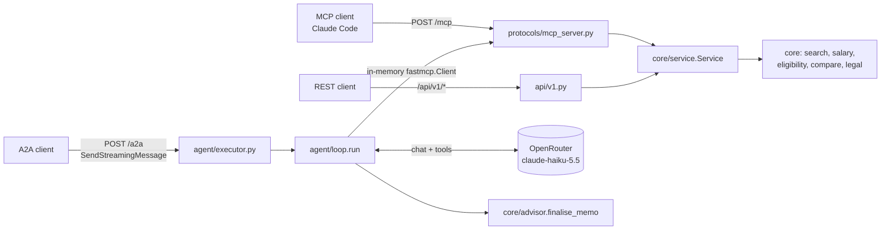

# Walkthrough: Feature 003, Lönekrav over MCP and A2A

This walkthrough follows three requests through the code: a tool call from an MCP client, a
streamed message to the advisor agent, and the same message sent with no model key. Every snippet
below was read from disk by a generator script on 2026-10-22, on branch
`003-mcp-a2a-protocols`, so it shows the code as it stands, not a paraphrase. Real outputs are in
`references/mcp-claude-code.md` and `references/a2a-stream.md`.



There is one set of operations, in `core/service.py`, and one set of tool definitions, in
`mcp_server.py`. REST and MCP call the service directly. The advisor reaches the same service
only through the MCP tools, so its tools cannot drift from what an MCP client sees.

## Part 1: one app, three surfaces

### 1. Wiring order in `create_app`

`src/lonekrav/app.py:45`

```python
    for name in CONTENT_LOGGERS:
        logger = logging.getLogger(name)
        logger.setLevel(max(logging.INFO, logger.level))
    app = FastAPI(title="Lönekrav", version="1",
                  openapi_url="/api/v1/openapi.json", docs_url="/api/v1/docs", redoc_url=None)
    app.include_router(v1.router, prefix="/api/v1")
    app.state.mcp = build_mcp(app)
    if chat_model is None and (key := os.environ.get("OPENROUTER_KEY")):
        chat_model = openrouter_model(key, os.environ.get("LONEKRAV_LLM_MODEL", DEFAULT_MODEL))
    add_a2a(app, app.state.mcp, chat_model)
    mcp_app = app.state.mcp.http_app(path="/mcp")  # mounted at "/" below: exactly /mcp (R2)
    app.router.lifespan_context = combine_lifespans(lifespan, mcp_app.lifespan)
```

The order matters in three places:

- **The logger pins come first**, before any library logs anything (section 13).
- **The MCP server is built before the A2A routes**, because the advisor's executor gets the MCP
  server object to call its tools.
- **The model is chosen here.** A test passes a fake as `chat_model`. Otherwise
  `OPENROUTER_KEY` decides between a real OpenRouter client and `None`. `None` is not an error:
  the advisor will decline politely (section 12). `create_app` reads only `os.environ`. `.env` is
  loaded by `main()`, so tests never pick up the developer's key by accident.

FastMCP's HTTP app has its own lifespan, which starts its session manager. Setting
`app.router.lifespan_context` to the combination runs both lifespans. Without it, `/mcp` answers
nothing, because the session manager never starts.

`src/lonekrav/app.py:76`

```python
    app.mount("/", mcp_app)  # last: a root mount takes every path registered after it
```

The MCP app is mounted at `/` and handles the path `/mcp`. Research R2 tried all three
arrangements, and this is the only one where `http://localhost:8000/mcp` answers 200 without a 307
redirect, which `claude mcp add` needs. The cost is that a root mount catches every route
registered after it. It therefore comes last, and the two REST tests that add probe routes at run
time insert them ahead of it (`tests/integration/test_api.py:add_route`).

### 2. The data each surface shares

`src/lonekrav/app.py:32`

```python
    async def lifespan(app: FastAPI):
        from lonekrav.core.profiles import load_profiles
        from lonekrav.core.salary import load_age_bands, load_distributions
        from lonekrav.core.search import SearchEngine
        from lonekrav.core.service import Service

        distributions, age_bands = salaries or (load_distributions(), load_age_bands())
        app.state.service = Service(
            engine=engine or SearchEngine.load(),
            profiles=profiles if profiles is not None else load_profiles(),
            distributions=distributions, age_bands=age_bands)
        yield
```

The lifespan builds one `Service` from the data it loads (or that tests inject) and stores it on
`app.state.service`. Everything below reads it from there when a request arrives. The MCP server
is built before the lifespan runs, so it cannot capture the service when it is created (research R3).

## Part 2: a tool call from an MCP client

### 3. The service: the rules that used to live in the REST adapter

`src/lonekrav/core/service.py:22`

```python
@dataclass(frozen=True)
class Service:
    engine: SearchEngine
    profiles: dict[str, OccupationProfile]
    distributions: list[SalaryDistribution]
    age_bands: list[AgeBandSalary]

    def _known(self, code: str) -> OccupationProfile:
        if code not in self.profiles:
            raise UnknownCode(code)
        return self.profiles[code]

    def search(self, req: SearchRequest) -> SearchAnswer:
        return run(req, self.engine)

    def parse_ad(self, req: AdText) -> ParsedAd:
        return parse(req.text, self.engine.embedders["kblab"])

    def salary(self, code: str, on: dt.date | None = None,
               age_band: str | None = None) -> SalaryPayload:
        """Raises UnknownCode, or ValueError for an unknown age band."""
        p = self._known(code)
        return payload(code, on=on or dt.date.today(), age_band=age_band,
                       distributions=self.distributions, age_bands=self.age_bands,
                       titles={code: (p.title_sv, p.title_en)})
```

`_known` is the not-found check that `api/v1.py` used to do inline. `salary` defaults the date to
today and supplies the titles, both of which REST also used to do. With these in core, REST, MCP
and the advisor return identical answers by construction. `tests/integration/test_mcp.py` checks
this, tool by tool, against the REST JSON (SC-001).

`src/lonekrav/core/service.py:57`

```python
    def occupation(self, code: str) -> OccupationProfile:
        """The profile with registry legal flags; ILO text is never served (ILO reserves rights)."""
        p = self._known(code)
        return p.model_copy(update={
            "legal_flags": flags_for(code),
            "descriptions": [d for d in p.descriptions if d.source.source != "ilo_isco08"]})
```

ILO text is never served. `attach_ilo` adds it at index time for search, and the profile served
here drops it. `tests/unit/test_service.py` plants an ILO description and checks that it
disappears, because the fixture profiles have no ILO text, so without the plant the test would
pass vacuously.

### 4. A tool is one call into the service

`src/lonekrav/protocols/mcp_server.py:25`

```python
def _expected(error: type[Exception] = ToolError) -> Iterator[None]:
    """Unknown codes and age bands reach the client with REST's text; anything else is masked."""
    try:
        yield
    except (UnknownCode, ValueError) as e:
        raise error(str(e)) from e
```

`src/lonekrav/protocols/mcp_server.py:55`

```python
    def get_occupation_salary(code: str, age_band: str | None = None,
                              on: dt.date | None = None) -> SalaryPayload:
        """SCB salary distribution for a four-digit SSYK code, the work-permit salary thresholds
        in force on date `on` (default today), and, for an age band such as "25-34", simulated
        age-adjusted figures marked is_simulated."""
        with _expected():
            return service().salary(code, on=on, age_band=age_band)
```

The tool's argument schema comes from its signature, and the return type gives the published
output schema. For the tools with a core request model (`search_occupations`,
`evaluate_permit_eligibility`, `compare_occupations`, `extract_job_ad_signal`), the argument is
that model itself (`request: SearchRequest`). Every pydantic constraint, such as the
20 000-character limit, two to five codes, or a four-digit pattern, therefore reaches the client
unchanged (FR-008).

`_expected` turns the two errors a user can cause, an unknown code and an unknown age band, into
a `ToolError` carrying REST's exact text. Anything else is masked by `mask_error_details=True`, as
REST's 500 handler masks it. The tests prove this by planting `RuntimeError("/Users/someone/secret/path.py")`.

### 5. Resources return JSON, not models

`src/lonekrav/protocols/mcp_server.py:78`

```python
    @mcp.resource("legal://timeline", mime_type="application/json")
    def legal_timeline() -> list[dict]:
        """Every dated work-permit salary rule and median, with its source and checked-on date."""
        return [e.model_dump(mode="json") for e in service().timeline()]

    @mcp.resource("ssyk://{code}", mime_type="application/json")
    def ssyk_profile(code: str) -> dict:
        """The profile of one SSYK 2012 code: titles, descriptions, synonyms and legal flags."""
        with _expected(ResourceError):
            return service().occupation(code).model_dump(mode="json")
```

fastmcp 4.1.3 cannot serialise a pydantic model from a resource function (research R5), so these
two dump to JSON themselves. The content is the same as the REST routes' and is tested the same way.

## Part 3: a streamed message to the advisor

### 6. The executor: from A2A message to request

`src/lonekrav/protocols/agent/executor.py:41`

```python
def _request(message: Message) -> AdvisorRequest | str:
    """The data part as an AdvisorRequest, any text joining its background; else the text."""
    texts = [t for t in get_text_parts(message.parts) if t.strip()]
    if datas := get_data_parts(message.parts):
        data = dict(datas[0])
        if texts:
            data["background"] = "\n\n".join(filter(None, [data.get("background"), *texts]))
        return AdvisorRequest.model_validate(data)
    return AdText(text="\n\n".join(texts)).text
```

The preferred input is one data part, `{ad, background?, offer?}`, validated as `AdvisorRequest`
(below). Any text parts join the background, so a UI can send structured fields plus a free-text
note. With only text, the text itself goes to the model, which reads the offer out of it. The
eligibility tool then validates whatever the model extracted.

`src/lonekrav/core/advisor.py:21`

```python
class AdvisorRequest(BaseModel):
    ad: str = AdText.model_fields["text"]
    background: str | None = Field(default=None, max_length=5_000,
                                   description="The applicant's education and experience")
    offer: Offer | None = Field(default=None, description="The offer, without a code")
```

`ad` reuses `AdText`'s field, constraints included, so the limit is written once. A2A data parts
arrive as protobuf `Value`s, in which every number is a float (52000 becomes 52000.0). Pydantic's
lax mode accepts a float with no fraction for an `int`, so no conversion code is needed.
`tests/unit/test_advisor.py` sends floats on purpose.

### 7. The executor: from loop events to A2A events

`src/lonekrav/protocols/agent/executor.py:62`

```python
    async def execute(self, context: RequestContext, event_queue: EventQueue) -> None:
        if context.current_task is None:  # the handler requires the Task first (research R7)
            await event_queue.enqueue_event(new_task_from_user_message(context.message))
        up = TaskUpdater(event_queue, context.task_id, context.context_id)

        def say(text: str) -> Message:
            return up.new_agent_message([new_text_part(text)])

        if self.model is None:  # research R8: declined, not broken
            await up.reject(say(UNAVAILABLE))
            return
        try:
            request = _request(context.message)
        except ValidationError as e:
            await up.failed(say(_invalid(e)))
            return
        await up.start_work(say("Reading the job ad"))
        try:
            async with McpTools(self.mcp) as tools:
                async for event in run(request, self.model, tools):
                    if isinstance(event, Progress):
                        await up.update_status(TaskState.TASK_STATE_WORKING, say(event.text))
                    elif isinstance(event, ToolResult):
                        await up.add_artifact([new_data_part({
                            "kind": "ui_sync", "tool": event.tool, "args": event.args,
                            "result": event.result})], name=f"ui_sync:{event.tool}")
                    elif isinstance(event, Memo):
                        memo = new_text_part(event.text, media_type="text/markdown")
                        await up.add_artifact([memo], name="memo", last_chunk=True)
        except RoundLimit as e:
            await up.failed(say(str(e)))
            return
        except Exception as e:  # noqa: BLE001 - the model service: timeouts, HTTP, API errors
            log.error("advisor run failed: %s", type(e).__name__)
            await up.failed(say(f"The model service failed ({type(e).__name__}). Try again later."))
            return
        await up.complete()
```

In order:

- **The Task is enqueued first.** a2a-sdk 1.2.3 raises if a status update arrives before it.
- **With no model**, the task is *rejected* (section 12).
- **An invalid data part** fails the task before any model call. `_invalid` keeps each
  error's location and message but drops pydantic's `input`, which would echo the salary or the
  ad text back into a failed-task message (FR-005).
- **Each loop event becomes one A2A event.** A `ToolResult` becomes a `ui_sync` data artifact
  carrying the full tool result, which is what the 004 chart drawer will draw from.
- **`except Exception` is deliberate** (marked `noqa`). Whatever the model service does (time
  out, return a 5xx, rate-limit), the task must end in a terminal state rather than hang. It logs
  only the exception's type.
- **`CancelledError` is a `BaseException`**, so this handler does not catch it, and a
  `CancelTask` really stops the run. `test_cancel_a_running_task` checks that the model call in
  flight is abandoned.

### 8. The loop

`src/lonekrav/protocols/agent/loop.py:110`

```python
async def run(request: AdvisorRequest | str, model: ChatModel,
              tools: Tools) -> AsyncIterator[Progress | ToolResult | Memo]:
    specs = await tools.specs()
    parameters = {s["function"]["name"]: s["function"].get("parameters", {}) for s in specs}
    messages: list[dict] = [{"role": "system", "content": SYSTEM_PROMPT},
                            {"role": "user", "content": _user_message(request)}]
    called: list[str] = []
    for _ in range(MAX_ROUNDS):
        reply = await model(messages, specs)
        if not reply.tool_calls:
            yield Memo(finalise_memo(reply.content or "", called))
            return
        messages.append({"role": "assistant", "content": reply.content, "tool_calls": [
            {"id": c.id, "type": "function",
             "function": {"name": c.name, "arguments": c.arguments}} for c in reply.tool_calls]})
        for c in reply.tool_calls:
            yield Progress(f"Calling {c.name}")
            try:
                args = json.loads(c.arguments or "{}")
            except json.JSONDecodeError as e:
                is_error, payload = True, f"Arguments are not valid JSON: {e}"
            else:
                if isinstance(args, dict):
                    args = _decode_objects(args, parameters.get(c.name, {}))
                    is_error, payload = await tools.call(c.name, args)
                else:
                    is_error, payload = True, "Arguments must be a JSON object."
            if is_error:
                yield Progress(f"{c.name} failed; the model is told why")
            else:
                called.append(c.name)
                yield ToolResult(c.name, args, payload)
            messages.append({"role": "tool", "tool_call_id": c.id,
                             "content": payload if is_error else json.dumps(payload)})
    raise RoundLimit(f"Stopped after {MAX_ROUNDS} model rounds without a memo.")
```

This is a plain OpenAI-style tool loop:

- It sends the system prompt and one user message.
- While the model asks for tools, it runs them, appends each result as a `tool` message, and asks
  again.
- When the model answers with text, that text is the memo.
- After `MAX_ROUNDS = 8` model calls without a memo, it gives up.

A failed tool call yields no `ToolResult`, so the UI only ever receives real results. The error
text goes to the model, which usually corrects itself on the next round.

`_decode_objects` exists because of a live run. On its first call in every run, Haiku 5.5 sent the
nested `request` argument as a JSON *string*, with a stray closing brace:

`src/lonekrav/protocols/agent/loop.py:94`

```python
def _decode_objects(args: dict, parameters: dict) -> dict:
    """Small models sometimes send an object argument as JSON text, even with a stray closing
    brace; take its leading object, but only where the tool's schema does not ask for a string."""
    props = parameters.get("properties", {})
    out = {}
    for name, value in args.items():
        if isinstance(value, str) and props.get(name, {}).get("type") != "string":
            try:
                decoded, _ = json.JSONDecoder().raw_decode(value.strip())
            except json.JSONDecodeError:
                decoded = value
            value = decoded if isinstance(decoded, dict) else value
        out[name] = value
    return out
```

`raw_decode` takes the leading object and ignores the trailing junk. This happens only where the
tool's schema does not ask for a string, so a real string argument that happens to look like JSON
is left alone. The fix saved one model round, about 2 s, per run (`references/a2a-stream.md`).
Claude Code, as an MCP client, never did this.

### 9. The tools the loop calls are the MCP server's

`src/lonekrav/protocols/agent/loop.py:147`

```python
class McpTools:
    """The MCP server's tools over the in-memory transport: the advisor's only tools (R6)."""

    def __init__(self, mcp):
        from fastmcp import Client

        self.client = Client(mcp)

    async def __aenter__(self) -> McpTools:  # noqa: PYI034
        await self.client.__aenter__()
        return self

    async def __aexit__(self, *exc) -> None:
        await self.client.__aexit__(*exc)

    async def specs(self) -> list[dict]:
        return [{"type": "function", "function": {"name": t.name, "description": t.description,
                                                  "parameters": t.input_schema}}
                for t in await self.client.list_tools()]

    async def call(self, name: str, args: dict) -> tuple[bool, Any]:
        r = await self.client.call_tool(name, args, raise_on_error=False)
        return (True, r.content[0].text) if r.is_error else (False, r.structured_content)
```

`specs()` turns `list_tools()` into OpenAI function specs, and `call()` goes through the
in-memory transport. The advisor therefore uses exactly the tools, schemas, validation and error
texts that an MCP client gets (research R6, FR-013). The cost of the in-process round trip is
negligible next to a model round. With `raise_on_error=False`, a tool error comes back as data,
not as an exception.

### 10. The model client

`src/lonekrav/protocols/agent/loop.py:172`

```python
def openrouter_model(key: str, model: str = DEFAULT_MODEL) -> ChatModel:
    """One client for the app's lifetime, made at start-up, so nothing is lazily shared (FR-018)."""
    from openai import AsyncOpenAI

    client = AsyncOpenAI(base_url=OPENROUTER_URL, api_key=key, timeout=30, max_retries=1)

    async def chat(messages: list[dict], tools: list[dict]) -> Reply:
        r = await client.chat.completions.create(model=model, messages=messages, tools=tools)
        m = r.choices[0].message
        return Reply(m.content, [ToolCall(c.id, c.function.name, c.function.arguments)
                                 for c in m.tool_calls or []])
    return chat
```

The client is created once, in `create_app`, with a 30-second timeout and one retry (FR-015). It
is created eagerly, so there is no lazy shared resource and no lock is needed (FR-018). The
default model and the measurements behind it are in research R9.

### 11. The memo guard

`src/lonekrav/core/advisor.py:28`

```python
def finalise_memo(memo: str, tools_called: list[str]) -> str:
    parts = [memo.strip()]
    if HONEST_FIT not in memo:
        parts.append(HONEST_FIT)
    if not tools_called and NO_RESULTS not in memo:
        parts.append(NO_RESULTS)
    if "not legal advice" not in memo.casefold():
        parts.append(DISCLAIMER)
    if not memo.rstrip().endswith(THIRD_PARTY_NOTICE):
        parts.append(THIRD_PARTY_NOTICE)
    return "\n\n".join(parts)
```

Whatever the model wrote, the memo leaves with these four guarantees:

- the core `HONEST_FIT` text, verbatim
- a not-legal-advice statement
- a warning if no Lönekrav tool succeeded, so a memo written from the model's own knowledge is
  labelled as such
- the third-party notice, as its final line

Each piece is added only if it is missing, so the guard is idempotent. This keeps SC-004 testable
without judging the model's prose.

The system prompt asks for the same things, but it is a request, not a guarantee. Because it is a
Python constant, the existing legal-literal scan (`test_no_legal_literal_outside_the_registry`)
covers it. Planting "34 470" in it makes that test fail. The prompt therefore cannot carry a
threshold, and every figure in a memo has to come from a tool result.

### 12. With no key

`create_app` passes `None` as the model, and the executor rejects:

`src/lonekrav/protocols/agent/executor.py:38`

```python
UNAVAILABLE = "Agent unavailable: no model key is configured (set OPENROUTER_KEY in .env)."
```

`rejected` rather than `failed`: in A2A, *rejected* means the agent declined the task, which is
true here, because nothing broke. A UI can show "set a key" instead of "try again". The card is
still served, and REST and MCP are unaffected (`test_no_key_*`).

## Part 4: what must never be logged

### 13. Three libraries log request bodies at DEBUG

`src/lonekrav/app.py:21`

```python
# Libraries that log request or response bodies at DEBUG: tool arguments (fastmcp), JSON-RPC
# requests (a2a) and every streamed chunk (sse_starlette). They never go below INFO (FR-005).
CONTENT_LOGGERS = ("fastmcp", "a2a", "sse_starlette")
```

The logging tests found all three by switching every logger to DEBUG and searching the output for
a planted ad text and salary:

- **fastmcp** logs `Handler called: call_tool search_occupations with {'request': {'text': ...}}`.
- **a2a-sdk** logs the whole JSON-RPC request.
- **sse_starlette** logs every streamed chunk, and chunks carry tool results, which repeat the ad text.

None of them does this at their default level. But a `FASTMCP_LOG_LEVEL=DEBUG`, or a
`basicConfig(level=DEBUG)` while debugging, would write applicants' ads and salaries to the log.
Pinning these loggers to INFO or above makes FR-005 hold however the process is configured.

fastmcp also does not propagate to the root logger, so `caplog` never sees its records by default.
The MCP logging test turns propagation on for that reason. Without that, the test would have
passed while proving nothing.

### 14. A test-infrastructure leak this feature exposed

Milvus Lite runs one in-process gRPC server per database path until the process exits. 003's
extra app fixtures pushed the pytest process to about 970 file descriptors and 260 threads. At
that point, tests that start a subprocess crashed in gRPC's fork handler on most full runs, and a
different test failed each time. An autouse fixture now stops each test's servers:

`tests/conftest.py:16`

```python
def _release_milvus_lite(tmp_path_factory):
    """Stop the Milvus Lite server each test's temporary index started.

    Milvus Lite runs one in-process gRPC server per database path until the process exits. With
    hundreds of them alive, a test that starts a subprocess (test_openmp_order, test_index_search)
    can crash in gRPC's fork handler. Only paths under pytest's temporary base are released, so
    the benchmark's module-scoped index on data/index keeps running."""
    yield
    import sys

    if "milvus_lite.server_manager" not in sys.modules:
        return
    from milvus_lite.server_manager import server_manager_instance as manager

    base = str(tmp_path_factory.getbasetemp())
    for path in [p for p in manager._servers if p.startswith(base)]:  # no public listing
        manager.release_server(path)
```

## Open questions and leftovers

- **Fast-mode search misses some full sentences.** For "Backend developer building Python APIs and
  maintaining our cloud services", fast mode ranks construction codes first (3112, 7116, …) and
  flags `low_confidence`. Full mode and the short query "backend developer" rank 2512 first. This
  was found by the Claude Code evidence run. It is a Feature 002 search question, not fixed here.
  It is a good case for the benchmark.
- **`compare`'s threshold line is labelled with the filing date.** `core.compare` builds the line
  with `on = offer.filed_on`, but for a first permit the rule is chosen by the decision date. The
  answers agree today. In the live run, though, the model repeated "applied to the filing date",
  which is not how Migrationsverket decides. This needs a look in core, outside 003.
- **The card's endpoint URL is fixed** at `http://localhost:8000/a2a`. 004's Docker setup will
  need it configurable.
- **Task state lives in memory**, so tasks are lost on restart (an accepted assumption in the spec).
