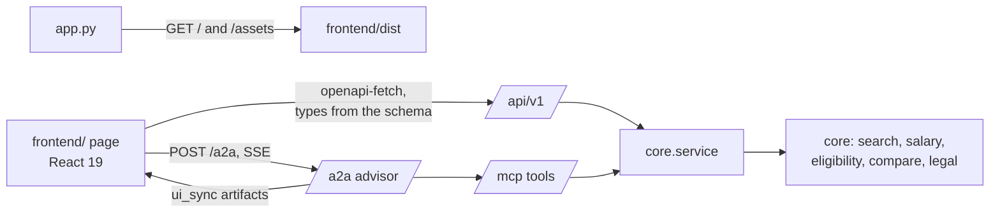

# Walkthrough: Feature 004, the web client and the container

This walkthrough follows a user through the page: typing a job title, pasting an ad, reading the
salary chart, checking an offer, and asking the advisor. It then follows the container from
`docker compose up` to a served page. Every snippet was read from disk by a generator script on
2026-10-22, on branch `004-web-client-docker`. The evidence is in `references/web-client-e2e.md`,
`references/container-smoke.md` and `references/container-memory.md`, and screenshots are in
`references/web-client-screenshots/`.



## 1. One app, one port: the page next to the root MCP mount

The MCP app is mounted at `/` so that its endpoint is exactly `/mcp` (003). A root mount catches
every path registered after it, so the page has to be registered before it:

`src/lonekrav/app.py:86`

```python
def _add_frontend(app: FastAPI, dist: Path) -> None:
    """The page keeps its state in the query string, so it needs only / and /assets: no catch-all
    route that would take /mcp from the root mount (research R2)."""
    index = dist / "index.html"
    if not index.is_file():
        @app.get("/", include_in_schema=False)
        def not_built():
            return JSONResponse({"detail": "frontend not built: run npm ci && npm run build in "
                                           "frontend/"}, status_code=404)
        return

    @app.get("/", include_in_schema=False)
    def page():
        return FileResponse(index)
    app.mount("/assets", StaticFiles(directory=dist / "assets"), name="assets")
```

The page keeps all its state in the query string, so it needs only `GET /` and `/assets/*`, and
no catch-all route that would take `/mcp`. Without a build, `/` says how to make one, and every
other surface works the same (`tests/integration/test_frontend_serving.py`).

The address is the page's only router. `parse` reads it once on load, and the App writes it back
with `history.replaceState`:

`frontend/src/lib/urlState.ts:17`

```ts
export function parse(search: string): { state: PageState; dropped: string[] } {
  const q = new URLSearchParams(search);
  const codes: string[] = [];
  const dropped: string[] = [];
  for (const c of (q.get("codes") ?? "").split(",").filter(Boolean)) {
    if (/^\d{4}$/.test(c) && !codes.includes(c) && codes.length < MAX_CODES) codes.push(c);
    else dropped.push(c);
  }
  const view = q.get("view");
  const age = q.get("age");
  return { state: { view: isView(view) ? view : "search", codes, age: isAge(age) ? age : null }, dropped };
}
```

## 2. Typing and pasting: two speeds, the latest text wins

Every change sends a fast search at once (KBLab and BM25) and, after 600 ms without typing, the
accurate one (adding Harrier). An answer is shown only if its text is still in the box, and a full
answer is never replaced by a fast one for the same text:

`frontend/src/lib/searchSession.ts:47`

```ts
  setText(text: string) {
    this.fast?.abort();
    this.full?.abort();
    clearTimeout(this.timer);
    if (!text.trim()) return this.set({ text, answer: null, answerFor: null, shown: null, refining: false, error: null });
    if (text.length > MAX_TEXT)
      return this.set({ text, refining: false, error: "The text is too long: the limit is 20 000 characters." });
    this.set({ text, refining: true, error: null });
    this.fast = this.send(text, "fast");
    this.timer = setTimeout(() => (this.full = this.send(text, "full")), PAUSE_MS);
  }

  private send(text: string, mode: "fast" | "full") {
    const ctl = new AbortController();
    this.search({ text, mode, k: 5, parse_ad: wantsParseAd(text) }, ctl.signal).then(
      (answer) => {
        if (text !== this.state.text || (mode === "fast" && this.fullFor === text)) return;
        this.fullFor = mode === "full" ? text : null;
        this.set({ answer, answerFor: text, shown: mode, refining: mode === "fast" ? this.state.refining : false });
      },
      (e) => {
        if (aborted(e) || text !== this.state.text) return;
        this.set({ error: "The search failed; showing the previous results.", refining: false });
      },
    );
    return ctl;
  }
}
```

`fullFor` was added test-first after a bug the first tests missed: once a full answer had been
shown, the next text's fast answer was dropped, because `shown` was still `"full"`. `answerFor` is
what the end-to-end tests wait on to time a keystroke to the list matching the box.

A pasted ad is searched by its job-describing passages (`parse_ad`). Real Swedish ads showed a
scoping bug in 002's parser, and this feature fixed it with a regression test first:

`src/lonekrav/core/adparse.py:97`

```python
    for i, line in enumerate(lines):
        if (h := _heading(line)) is not None:
            section = h
            continue
        if i == 0 and _is_title(line):
            rows.append((line.strip(), "title", "position"))
            continue
        if section and _is_title(line) and not _BULLET.match(line):
            section = None  # a heading not in HEADINGS ends the one before it; anchors decide
        for s in _sentences(line):
            rows.append((s, section, "heading") if section else (s, None, "anchor"))
```

Before the fix, "Om tjänsten" (a duty heading) labelled everything after it, including benefits
and the town description, because "Dina förmåner som anställd" is not in the heading list. A short
non-bullet line that looks like a heading now ends the section.

## 3. What a result may show: ILO text ranks but is never served

Search returns the best chunk's text as the matched passage. 1 525 of 9 554 chunks are ILO ISCO-08
text, which ILO reserves the rights to, and the page made this visible. Each chunk now records `ilo`
at index time. A hit whose ranking chunk is ILO text shows the method's best other chunk, or the
title:

`src/lonekrav/core/search.py:71`

```python
def displayable(hits: Sequence[ChunkHit]) -> dict[str, ChunkHit]:
    """Best chunk per occupation that may be shown: ILO ISCO-08 text ranks but is never served."""
    return dict(reduce_to_codes([h for h in hits if not h.ilo]))
```

`src/lonekrav/core/search.py:97`

```python
        if best.ilo:
            by_rank = sorted((m for m in methods if code in ranks[m]), key=lambda m: ranks[m][code])
            best = next((shown[m][code] for m in by_rank if code in shown.get(m, {})),
                        ChunkHit(chunk_id=f"{code}:title:0", code=code, kind="title", text="",
                                 score=0.0))
```

Chunk texts did not change, so the cached embeddings were reused (re-index 21 s), and the
benchmark is identical. `tests/integration/test_no_ilo_text_served.py` sends ILO texts as queries
through REST and checks that none comes back.

## 4. The salary chart: positions from the page, figures from the API

`chartRows` decides what each row shows. It never chooses a legal rule: the floor is the threshold
named by the payload's `applicable_rule_id`, or the rule and amount of the code's eligibility answer
when an offer has been entered:

`frontend/src/components/SalaryChart.tsx:32`

```tsx
export function chartRows(payloads: SalaryPayload[], eligibility: Record<string, EligibilityAnswer | null>,
  simulatedOn: Record<string, boolean>): Row[] {
  return payloads.map((p) => {
    const d = p.distributions.at(-1) ?? null;
    const notes: string[] = [];
    if (!d) notes.push("SCB publishes no salary figures for this code.");
    else if (d.suppressed.length)
      notes.push(`SCB does not publish ${d.suppressed.filter((f) => f !== "mean").join(", ") || "the mean"} for this code${
        d.suppressed.length >= 5 ? ": no salary bar can be drawn" : ""}.`);
    const answer = eligibility[p.code];
    let floor: Floor | null = null;
    if (answer) {
      if (answer.status !== "not_permitted" && answer.rule_id && answer.threshold_sek != null)
        floor = { rule: answer.rule_id, amount: answer.threshold_sek, percent: answer.percent ?? null };
    } else {
      const line = p.thresholds.find((t) => t.rule_id === p.applicable_rule_id);
      if (line) floor = { rule: line.rule_id, amount: line.amount_sek, percent: line.percent };
    }
    if (!floor) notes.push("Permits cannot be granted for this code, so no salary floor is drawn.");
    const tables = [...new Set([...p.distributions.slice(-1), ...p.age_bands].map(
      (t) => `${t.source_table} (${t.reference_year})`))];
    return {
      code: p.code,
      title_en: p.title_en,
      title_sv: p.title_sv,
      bar: d?.p10 != null && d.p90 != null ? { p10: d.p10, p90: d.p90, p25: d.p25 ?? null } : null,
      median: d?.median ?? null,
      ages: p.age_bands.filter((a) => a.age_band !== "all" && a.mean_monthly != null)
        .map((a) => ({ band: a.age_band, mean: a.mean_monthly! })),
      floor,
      simulated: simulatedOn[p.code] && p.simulated ? p.simulated : null,
      notes,
      tables,
    };
  });
}
```

Suppressed SCB values stay out, with a note. The simulated bar is drawn only when switched on,
dashed and labelled "not an SCB figure", with its formula. All rows share one zero-based scale:

`frontend/src/lib/chartScale.ts:2`

```ts
const STEP = 10_000;

export function scale(values: (number | null | undefined)[], width: number) {
  const top = Math.max(0, ...values.filter((v): v is number => v != null));
  const max = Math.max(STEP, Math.ceil(top / STEP) * STEP);
  const ticks = Array.from({ length: max / STEP + 1 }, (_, i) => i * STEP);
  return { max, ticks, x: (v: number) => (v / max) * width };
}
```

The colours came from the `dataviz` skill's validator (an ordinal blue ramp for the band and bar,
and a categorical blue/orange pair for the bar and age dots, light and dark). The chart draws at its
measured width, so marks and tick labels keep their size on a phone.

## 5. The offer: validated by the API, shared by every view

The page never validates an offer itself. `OfferPanel` posts the draft to `/eligibility` with a
code. A 422 comes back as one plain message per field, and a model-level message goes to the first
field it names:

`frontend/src/lib/offer.ts:46`

```ts
export function fieldErrors(detail: Problem[]): Partial<Record<keyof Draft | "form", string>> {
  const out: Partial<Record<keyof Draft | "form", string>> = {};
  for (const { loc, msg } of detail) {
    const plain = msg.replace(/^Value error, /, "");
    const named = FIELDS.filter((f) => plain.includes(f)).sort((a, b) => plain.indexOf(a) - plain.indexOf(b));
    const field = FIELDS.find((f) => loc.includes(f)) ?? named[0] ?? "form";
    const words = FIELDS.reduce((m, f) => m.replaceAll(f, LABELS[f]), plain);
    out[field] = `${words[0].toUpperCase()}${words.slice(1)}${words.endsWith(".") ? "" : "."}`;
  }
  return out;
}
```

## 6. The advisor drawer: SSE over fetch, and the chart follows

A2A streaming is a POST, so `EventSource` cannot be used. The client reads the body as a byte
stream and splits it into events at blank lines. The server sends CRLF line endings, a character can
be split across chunks, and a JSON-RPC error arrives as plain JSON. The tests replay the captured
bytes (`references/a2a-sse-wire.md`) in 7-byte chunks:

`frontend/src/lib/a2aClient.ts:46`

```ts
async function* sseData(body: ReadableStream<Uint8Array>): AsyncGenerator<string> {
  const reader = body.getReader();
  const decoder = new TextDecoder(); // stream mode keeps a UTF-8 character split across chunks whole
  let buffer = "";
  for (;;) {
    const { value, done } = await reader.read();
    if (done) return;
    buffer = (buffer + decoder.decode(value, { stream: true })).replace(/\r\n/g, "\n");
    let end: number;
    while ((end = buffer.indexOf("\n\n")) >= 0) {
      const event = buffer.slice(0, end);
      buffer = buffer.slice(end + 2);
      const data = event.split("\n").filter((l) => l.startsWith("data:")).map((l) => l.slice(5).trimStart());
      if (data.length) yield data.join("\n");
    }
  }
}
```

Each `ui_sync` artifact is a tool's result. A salary lookup or a comparison selects its codes on the
chart through the same reducer the user's clicks go through, so the most recent change wins,
whichever side made it:

`frontend/src/components/AdvisorDrawer.tsx:48`

```tsx
    else if (e.type === "ui_sync" && e.tool === "get_occupation_salary") {
      const payload = e.result as SalaryPayload;
      dispatch({ type: "advisor", codes: [payload.code] });
      dispatch({ type: "payload", code: payload.code, payload });
      setRun((r) => ({ ...r, selected: [...new Set([...r.selected, payload.code])] }));
    } else if (e.type === "ui_sync" && e.tool === "compare_occupations") {
      const codes = (e.result as Comparison).columns.map((c) => c.code);
      dispatch({ type: "advisor", codes });
      setRun((r) => ({ ...r, selected: [...new Set([...r.selected, ...codes])] }));
```

`frontend/src/lib/selection.ts:40`

```ts
    case "advisor": {
      const all = [...s.codes.filter((c) => !a.codes.includes(c)), ...a.codes];
      const kept = all.slice(-MAX_CODES);
      const leftOut = all.filter((c) => !kept.includes(c));
      return withCodes(s, kept, leftOut.length ? `Left out to keep four: ${leftOut.join(", ")}.` : null, leftOut);
    }
```

## 7. The container

One image holds the page, the server, both search models (downloaded at build time at their pinned
revisions) and the index. It runs offline:

`docker/Dockerfile:12`

```dockerfile
# 2. The server, its models and the index
FROM python:3.12-slim
COPY --from=ghcr.io/astral-sh/uv:0.9.9 /uv /bin/uv
ENV UV_COMPILE_BYTECODE=1 UV_LINK_MODE=copy UV_PYTHON_DOWNLOADS=never \
    HF_HOME=/models PATH=/app/.venv/bin:$PATH
WORKDIR /app
# Milvus Lite writes a lock and its log beside the index, so the app user owns data/.
RUN useradd --create-home app && install -d -o app /app/data
COPY pyproject.toml uv.lock ./
# uv's download cache stays in a build cache, not in the image (it was 1.5 GB).
RUN --mount=type=cache,target=/root/.cache/uv uv sync --frozen --no-dev --no-install-project
COPY src/ src/
RUN --mount=type=cache,target=/root/.cache/uv uv sync --frozen --no-dev
# The pinned models, downloaded once here; the container then never goes to the network for them.
RUN lonekrav-etl fetch-models
COPY --chown=app data/processed/ data/processed/
COPY --chown=app data/lonekrav_milvus.db/ data/lonekrav_milvus.db/
COPY --chown=app data/lonekrav_milvus.db.vocab.json data/
COPY --from=page /frontend/dist/ frontend/dist/
USER app
ENV HF_HUB_OFFLINE=1 HOST=0.0.0.0 PORT=8000 PYTHONUNBUFFERED=1
EXPOSE 8000
CMD ["lonekrav-serve"]
```

Three things were found by building and measuring it:

- **CUDA libraries**: PyPI's Linux torch wheels pull in the CUDA stack, on arm64 too. torch is now a
  direct dependency taken from the PyTorch CPU index on Linux (`pyproject.toml`), and macOS keeps
  the same wheel.
- **uv's download cache**: it was in the image, 1.5 GB of it. A build cache mount dropped the image
  from 5.46 GB to 3.85 GB.
- **Memory**: under a 4 GB cap, process memory sat at the limit once Harrier loaded, with swap
  absorbing it. Uncapped, the peak is 4.54 GiB, and the maintainer raised the cap to 5 GB
  (`references/container-memory.md`).

`docker-compose.yml:4`

```yaml
services:
  lonekrav:
    build:
      context: .
      dockerfile: docker/Dockerfile
    image: lonekrav:latest
    ports:
      - "${LONEKRAV_PORT:-8000}:8000"  # the host port; set it if 8000 is taken
    mem_limit: 5g  # measured peak 4.54 GiB with both models loaded (references/container-memory.md)
    environment:
      OPENROUTER_KEY: ${OPENROUTER_KEY:-}
      LONEKRAV_LLM_MODEL: ${LONEKRAV_LLM_MODEL:-}
      LONEKRAV_PUBLIC_URL: ${LONEKRAV_PUBLIC_URL:-}
```

Compose passes an unset variable as an empty string, so the app treats an empty
`LONEKRAV_LLM_MODEL` as unset (test first). The agent card's address comes from
`LONEKRAV_PUBLIC_URL`.

## What is still open

- **SC-003 is not met on two real ads**: an English ad and its Swedish translation give different
  top-three codes, for an ICU nurse and a backend developer (`references/web-client-e2e.md`). The
  difference is ranking, which this feature does not change.
- **The image carries ILO text in its index**, used for ranking only. The README says to push it
  only to a private registry.
