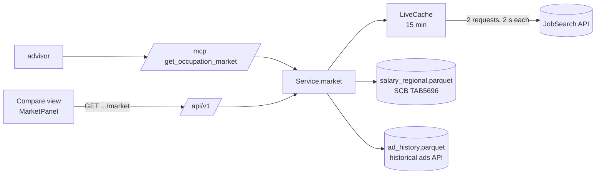

# Walkthrough: Feature 005, market pulse

This walkthrough follows one request for a code's market, `GET /api/v1/occupations/2512/market`,
from the route to the three sources behind it, then the ETL that builds two of them ahead of time,
and the panel that shows the answer. Every snippet was read from disk by a generator script on
2026-10-23, on branch `005-market-pulse`. Evidence: `references/market-pulse.md`.



## 1. One call for every surface

REST and MCP each make one call into the service, as for every other operation (Principle I):

`src/lonekrav/api/v1.py:55`

```python
@router.get("/occupations/{code}/market")
def market(code: str, request: Request) -> MarketAnswer:
    return _service(request).market(code)
```

`src/lonekrav/protocols/mcp_server.py:85`

```python
    def get_occupation_market(code: str) -> MarketAnswer:
        """Labour-market context for one SSYK code: open ads and positions on Platsbanken now, by
        county; SCB's mean monthly salary in each national area; and ads per year since 2016.
        Context only: it never changes which code fits the duties or the salary floor, and must
        not be used to choose or rank codes."""
        with _expected():
            return service().market(code)
```

The tool's description is what a chat model reads, so it says what the data is not for. The
advisor lists the MCP tools at run time, so it got the tool without a change to its loop. Only its
prompt changed, with one optional step:

`src/lonekrav/protocols/agent/loop.py:30`

```text
4. Optionally, call get_occupation_market for the plausible codes, to mention how many ads are
   open now or what the code pays on average in the applicant's area, each figure with its source
   and date. Never use open ads or pay as a reason to prefer or rank a code.
```

The service checks the code and hands over what it loaded at start-up:

`src/lonekrav/core/service.py:74`

```python
    def market(self, code: str) -> MarketAnswer:
        """Open ads now, regional means and yearly ads for a code: context, never a reason to
        choose it. A live failure is part of the answer, not an exception (FR-005)."""
        return market(self._known(code), self.profiles, self.live, self.regional, self.history)
```

## 2. The answer: three parts, each with its own status

`market()` puts the parts together. Codes that JobTech merges (1211 and 1212 as 1210) share
one concept id, so `shared_with` is just the other profiles with the same id. A code with no
concept (4430, 5322, 5324, 7619) makes no request at all:

`src/lonekrav/core/market.py:154`

```python
def market(profile: OccupationProfile, profiles: dict[str, OccupationProfile], live: LiveCache,
           regional: list[RegionalSalary], history: list[YearlyAds]) -> MarketAnswer:
    concept = profile.jobtech_concept_id
    shared = sorted(c for c, p in profiles.items()
                    if concept and p.jobtech_concept_id == concept and c != profile.code)
    rows = [r for r in regional if r.code == profile.code]
    year = max((r.year for r in rows), default=None)
    latest = sorted((r for r in rows if r.year == year),
                    key=lambda r: (r.region != "SE", r.region))  # Sweden first, then the areas
    return MarketAnswer(
        code=profile.code, title_sv=profile.title_sv, title_en=profile.title_en,
        shared_with=shared,
        live=live.get(concept) if concept else LiveDemand(status="no_concept"),
        regional_year=year, regional=latest,
        history_status="available" if concept else "no_concept",
        history=sorted((h for h in history if concept and h.concept_id == concept),
                       key=lambda h: h.year))
```

The notice travels with every answer, so the page, a chat client and the advisor all receive
the honest-fit rule and the warning that a mean is not a median:

`src/lonekrav/core/market.py:30`

```python
MARKET_NOTICE = (
    "The SSYK code on a work-permit offer must match the duties actually performed. Open ads and "
    "regional pay are context: they are never a reason to choose a code. Regional figures are SCB "
    "means; the work-permit salary floor comes from the national median and is the same in every "
    "area.")
```

## 3. Live demand: two requests, reused for 15 minutes

The surprise of this feature: JobSearch reports `positions: 0` whenever `stats` is in the
request. A plain request gives the true ads and positions, and a stats request gives the
counties. `parse_live` takes one of each:

`src/lonekrav/core/market.py:85`

```python
def parse_live(concept: str, plain: dict, stats: dict, *, fetched_at: dt.datetime,
               url: str) -> LiveDemand:
    """`plain` gives ads and positions; `stats` gives the counties (it reports positions as 0).
    Raises ValueError for a body that is not a JobSearch answer."""
    try:
        values = next(s["values"] for s in stats["stats"] if s["type"] == "region")
        counties = sorted((CountyCount(name=v["term"], code=v["code"], ads=v["count"])
                           for v in values), key=lambda c: -c.ads)
        ads, positions = int(plain["total"]["value"]), int(plain["positions"])
        no_county = int(stats["total"]["value"]) - sum(c.ads for c in counties)
    except (KeyError, TypeError, StopIteration) as e:
        raise ValueError(f"unexpected JobSearch answer: {e!r}") from e
    query = f"{url}?{urlencode(_params(concept, stats=False))}"
    return LiveDemand(status="available", concept_id=concept, ads=ads, positions=positions,
                      counties=counties, no_county=max(no_county, 0), fetched_at=fetched_at,
                      source=SourceRef(source="jobtech_jobsearch",
                                       ref=f"occupation-group={concept}", url=query))
```

The ads with no county come from the stats response's own total, so the county list and
"no county given" always add up. The cache keeps only available answers. A failure goes back to
the caller and is retried on the next request, so an API that recovers is seen at once:

`src/lonekrav/core/market.py:114`

```python
class LiveCache:
    """Live counts per concept, reused for `ttl`. Only available answers are kept, so an API that
    recovers is seen on the next request. Fetches run outside the lock: two requests for the same
    concept at once may both fetch, which is harmless."""

    def __init__(self, get_json: GetJson | None = None, base_url: str = JOBSEARCH_URL,
                 clock: Callable[[], dt.datetime] = lambda: dt.datetime.now(dt.UTC),
                 ttl: dt.timedelta = TTL):
        self.get_json = get_json or _http_get_json()
        self.base_url, self.clock, self.ttl = base_url, clock, ttl
        self._kept: dict[str, LiveDemand] = {}
        self._lock = threading.Lock()

    def get(self, concept: str) -> LiveDemand:
        now = self.clock()
        with self._lock:
            kept = self._kept.get(concept)
        if kept and now - kept.fetched_at < self.ttl:
            return kept
        try:
            plain = self.get_json(self.base_url, _params(concept, stats=False))
            stats = self.get_json(self.base_url, _params(concept, stats=True))
            fresh = parse_live(concept, plain, stats, fetched_at=now, url=self.base_url)
        except (httpx.HTTPError, json.JSONDecodeError, ValueError) as e:
            return LiveDemand(status="unavailable", concept_id=concept, reason=_reason(e))
        with self._lock:
            self._kept[concept] = fresh
        return fresh
```

Each failure becomes a reason the page can show, and never a number:

`src/lonekrav/core/market.py:104`

```python
def _reason(e: Exception) -> str:
    if isinstance(e, httpx.TimeoutException):
        return "timeout"
    if isinstance(e, httpx.HTTPStatusError):
        return f"http {e.response.status_code}"
    if isinstance(e, httpx.TransportError):
        return "connection error"
    return "unexpected response"  # bad JSON, or a body parse_live rejects
```

With a 2 s timeout per request, an address that never answers gives `unavailable timeout` in
2.0 s: the first request fails and the second is never sent. A closed port takes 2 ms. In the
tests, `LiveCache` gets a fake `get_json` and a clock, and the shared `api_client` fixture passes
one that always raises `ConnectError`, so the default test run never touches the network:

`tests/conftest.py:86`

```python
def offline(url, params):
    """A JobSearch that cannot be reached: the default test run never calls the real one (FR-007)."""
    import httpx

    raise httpx.ConnectError("offline in tests")
```

## 4. Regional pay: TAB5696, built ahead of time

The development plan named TAB4185 for regional pay. Its label, "inom regioner", means pay within
the regions as employers (the county health-care authorities), so this feature uses TAB5696 by
national area instead. It is fetched in English, so the area names arrive ready for the page:

`src/lonekrav/etl/scb_pxweb.py:27`

```python
REGIONAL_TABLE = "TAB5696"
REGIONAL_FIELD = {"000007AS": "mean", "000007AU": "mean_ci95", "000007AP": "employees"}
```

`src/lonekrav/etl/scb_pxweb.py:132`

```python
def parse_regional(path: Path, fetched_at: dt.datetime) -> list[RegionalSalary]:
    names = json.loads(path.read_text())["dimension"]["Region"]["category"]["label"]
    grouped: dict[tuple[str, int, str], dict] = {}
    for c in _cells(path):
        if c["Yrke2012"] in NOT_OCCUPATIONS or c["ContentsCode"] not in REGIONAL_FIELD:
            continue
        key = (c["Yrke2012"], int(c["Tid"]), c["Region"])
        grouped.setdefault(key, {})[REGIONAL_FIELD[c["ContentsCode"]]] = c["value"]
    return [RegionalSalary(code=code, year=year, region=region, region_name=names[region],
                           source_table=REGIONAL_TABLE, reference_year=year,
                           fetched_at=fetched_at, mean=v.get("mean"),
                           mean_ci95=v.get("mean_ci95"), employees=v.get("employees"))
            for (code, year, region), v in sorted(grouped.items())]
```

The fields are keyed by content code rather than by label, because the labels are English
here and Swedish in the other tables. The model lets the mean and the employee count be
suppressed on their own: for 2512 in 2025, four areas publish a mean but not a headcount.

`src/lonekrav/core/models.py:147`

```python
class RegionalSalary(BaseModel):
    """SCB's mean monthly salary for one code in Sweden (SE) or one national area (Feature 005).
    A mean, not the median the salary floor is based on; each figure is null where SCB suppresses
    it, independently of the others."""
    code: Code = Field(pattern=r"^\d{4}$")
    year: int = Field(ge=2023)
    region: str
    region_name: str
    mean: int | None
    mean_ci95: int | None = None  # ± margin, as SCB publishes it
    employees: int | None
    source_table: Literal["TAB5696"]
    reference_year: int
    fetched_at: dt.datetime

    @computed_field
    @property
    def suppressed(self) -> list[str]:
        return [f for f in ("mean", "employees") if getattr(self, f) is None]
```

In the answer, only the latest year is shown, with Sweden first. A cheap check guards the
table choice: TAB5696's Sweden row must equal TAB5932's mean for every code and year in both:

`tests/integration/test_regional_data.py:10`

```python
def test_sweden_row_equals_the_national_mean():
    national = {(d.code, d.year): d.mean for d in load_distributions()}
    pairs = [(r.mean, national[(r.code, r.year)]) for r in load_regional()
             if r.region == "SE" and (r.code, r.year) in national]
    assert len(pairs) > 1000
    assert [p for p in pairs if p[0] != p[1]] == []
```

## 5. Yearly ads: 4 000 small cached files

The historical API answers one concept and one year per request. Each answer becomes its own
cached file, so an interrupted fetch picks up where it stopped:

`src/lonekrav/etl/jobsearch.py:38`

```python
def fetch_history(raw: Path, concepts: list[str], year_list: list[int],
                  force: bool = False) -> None:
    client = httpx.Client(timeout=60, headers={"User-Agent": USER_AGENT})

    def one(job: tuple[str, int]) -> None:
        concept, year = job
        cached_get("jobsearch_history", URL, path_for(raw, concept, year), client=client,
                   force=force, validate=_validate,
                   params={"occupation-group": concept, "limit": "0",
                           "historical-from": f"{year}-01-01T00:00:00",
                           "historical-to": f"{year}-12-31T23:59:59"})

    jobs = [(c, y) for c in concepts for y in year_list]
    try:
        with ThreadPoolExecutor(THREADS) as pool:
            for i, _ in enumerate(pool.map(one, jobs), 1):
                if i % 500 == 0:
                    print(f"  jobsearch_history: {i}/{len(jobs)}", flush=True)
    finally:
        client.close()
```

The build refuses to guess. A missing file stops it with the command that fixes it, and 0 is
stored as 0:

`src/lonekrav/etl/jobsearch.py:64`

```python
def build_history(raw: Path, concepts: list[str], year_list: list[int]) -> list[YearlyAds]:
    rows = []
    for concept in concepts:
        for year in year_list:
            p = path_for(raw, concept, year)
            if not p.exists():
                raise FileNotFoundError(f"jobsearch_history: no count for {concept} in {year} "
                                        f"({p}); run lonekrav-etl fetch --only jobsearch_history")
            rows.append(YearlyAds(concept_id=concept, year=year, ads=parse_year(p),
                                  fetched_at=read_meta(p).fetched_at))
    return rows
```

Each row carries its file's `fetched_at`, not the time of the build, so building twice still
gives identical bytes (`test_idempotent.py`, which now writes a zero count per concept and year
as its history fixture). A check of the filter: for 2512, the twelve months of 2025 add up to the
year's 30 304 ads, so a year is counted by publication date.

## 6. The panel

`MarketPanel` fetches its own answer and only displays it. The page computes no figure. The
floor appears in a sentence, never as a line through the regional table, because a mean drawn
against a median-based threshold would invite a wrong comparison (FR-010):

`frontend/src/components/MarketPanel.tsx:49`

```tsx
function PayByArea({ a, floor }: { a: MarketAnswer; floor: number | null }) {
  const label = `Pay by area${a.regional_year ? ` (${a.regional_year})` : ""}`;
  const np = <span className="text-muted">not published</span>;
  return (
    <section aria-label={label} className="space-y-1">
      <h5 className="text-xs font-semibold uppercase text-muted">{label}</h5>
      <p className="text-muted">
        These are mean salaries. The work-permit floor
        {floor != null && <> ({sek(floor)})</>} comes from the national median and is the same in every area.
```

The yearly chart has one series, so it has no legend. The bars rise from one baseline with
rounded tops. Only the peak, the last year and any zero year carry a value label, and the
table view holds the rest:

`frontend/src/components/MarketPanel.tsx:88`

```tsx
function YearBars({ rows }: { rows: YearlyAds[] }) {
  const { ref, width } = useWidth();
  const max = Math.max(1, ...rows.map((r) => r.ads));
  const band = width / rows.length;
  const bar = Math.max(4, band * 0.6);
  const y = (v: number) => CHART_H - (v / max) * (CHART_H - LABEL_H);
  const every = band < 36 ? 2 : 1; // year labels need about 32 px each
  const peak = rows.findIndex((r) => r.ads === max);
```

The first screenshot showed the last bar's label clipped at the right edge. It is now anchored
at the bar's right end. Screenshots: `references/web-client-screenshots/compare-{phone,desktop}.png`.

## What is still open

- Live counts reflect whatever JobSearch reports at the time. An ad coded only to a broader
  occupation level is not counted under any 4-digit code.
- Regional pay is means only, by national area. SCB publishes no percentiles or county figures
  per 4-digit code.
- The history ends at the last full year. A rebuild in January needs a new
  `fetch --only jobsearch_history` first, or the build fails, by design.
